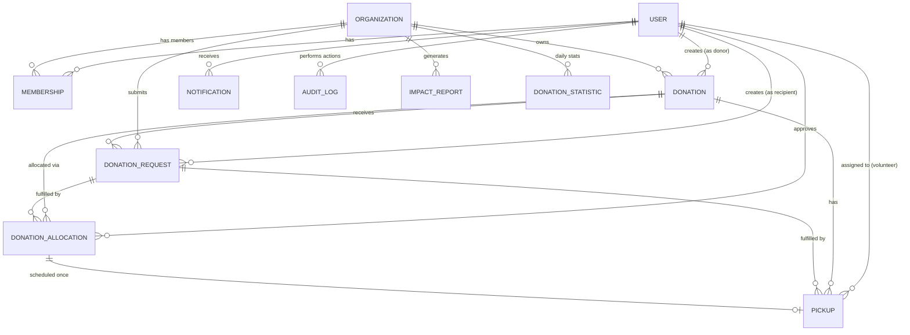

# ShareHarvest Data Models

## Entity Relationship Diagram



## Model Definitions

### accounts.User (Custom User Model)
```python
class User(AbstractUser):
    ROLE_CHOICES = [
        ('donor', 'Donor'),
        ('recipient', 'Recipient'),
        ('volunteer', 'Volunteer'),
        ('admin', 'Administrator'),
    ]
    
    role = CharField(max_length=20, choices=ROLE_CHOICES, default='donor')
    phone = CharField(max_length=20, blank=True)
    is_verified = BooleanField(default=False)
    created_at = DateTimeField(auto_now_add=True)
    updated_at = DateTimeField(auto_now=True)
```
**Table**: `users`
**Key Fields**: id, username, email, first_name, last_name, role, phone, is_verified
**Indexes**: `role`, `email`

---

### organizations.Organization
```python
class Organization(models.Model):
    ORG_TYPE_CHOICES = [
        ('restaurant', 'Restaurant'),
        ('hotel', 'Hotel'),
        ('supermarket', 'Supermarket'),
        ('mall', 'Shopping Mall'),
        ('catering', 'Catering Company'),
        ('event', 'Event Organizer'),
        ('ngo', 'NGO / Charity'),
        ('trust', 'Trust'),
        ('community', 'Community Organization'),
        ('other', 'Other'),
    ]
    
    STATUS_CHOICES = [
        ('pending', 'Pending Verification'),
        ('verified', 'Verified'),
        ('rejected', 'Rejected'),
    ]
    
    name = CharField(max_length=255)
    org_type = CharField(max_length=20, choices=ORG_TYPE_CHOICES)
    description = TextField(blank=True)
    address = TextField()
    city = CharField(max_length=100)
    state = CharField(max_length=100)
    postal_code = CharField(max_length=20)
    country = CharField(max_length=100, default='India')
    phone = CharField(max_length=20)
    email = EmailField()
    website = URLField(blank=True)
    status = CharField(max_length=20, choices=STATUS_CHOICES, default='pending')
    verified_at = DateTimeField(null=True, blank=True)
    verified_by = ForeignKey(User, SET_NULL, null=True, blank=True, related_name='verified_organizations')
    created_at = DateTimeField(auto_now_add=True)
    updated_at = DateTimeField(auto_now=True)
```
**Table**: `organizations`
**Indexes**: `status`, `org_type`, `(city, state)`

---

### organizations.Membership
```python
class Membership(models.Model):
    ROLE_CHOICES = [
        ('owner', 'Owner'),
        ('admin', 'Admin'),
        ('member', 'Member'),
        ('volunteer', 'Volunteer'),
    ]
    
    user = ForeignKey(User, CASCADE, related_name='memberships')
    organization = ForeignKey(Organization, CASCADE, related_name='memberships')
    role = CharField(max_length=20, choices=ROLE_CHOICES, default='member')
    joined_at = DateTimeField(auto_now_add=True)
    is_active = BooleanField(default=True)
    
    class Meta:
        unique_together = ['user', 'organization']
        indexes = [
            Index(fields=['user', 'is_active']),
            Index(fields=['organization', 'is_active']),
        ]
```
**Table**: `memberships`
**Key Constraint**: `unique_together = ['user', 'organization']` prevents duplicate memberships.

---

**Authorization Note**: The `volunteer` role in Membership is organization-scoped and grants pickup-related permissions within that organization only. Platform-level volunteer permissions (if any) are determined by `User.role = 'volunteer'`. These two role systems are distinct: `User.role` defines the user's primary platform identity, while `Membership.role` defines their permissions within a specific organization. Do not conflate them.

### donations.Donation
```python
class Donation(models.Model):
    FOOD_CATEGORY_CHOICES = [...]
    STATUS_CHOICES = [
        ('draft', 'Draft'),
        ('published', 'Published'),
        ('reserved', 'Reserved'),
        ('completed', 'Completed'),
        ('expired', 'Expired'),
        ('cancelled', 'Cancelled'),
    ]
    UNIT_CHOICES = [
        ('kg', 'Kilograms'), ('g', 'Grams'),
        ('l', 'Liters'), ('ml', 'Milliliters'),
        ('units', 'Units/Items'), ('boxes', 'Boxes'), ('trays', 'Trays'),
    ]
    MASS_UNITS = {'kg', 'g'}
    VOLUME_UNITS = {'l', 'ml'}
    COUNT_UNITS = {'units', 'boxes', 'trays'}
    
    donor = ForeignKey(User, CASCADE, related_name='donations')
    organization = ForeignKey(Organization, CASCADE, related_name='donations')
    title = CharField(max_length=255)
    description = TextField()
    food_category = CharField(max_length=20, choices=FOOD_CATEGORY_CHOICES)
    quantity = DecimalField(max_digits=10, decimal_places=2)
    unit = CharField(max_length=10, choices=UNIT_CHOICES)
    quantity_kg = DecimalField(max_digits=10, decimal_places=3, editable=False)
    available_from = DateTimeField()
    available_until = DateTimeField()
    pickup_address = TextField()
    pickup_instructions = TextField(blank=True)
    status = CharField(max_length=20, choices=STATUS_CHOICES, default='draft')
    published_at = DateTimeField(null=True, blank=True)
    created_at = DateTimeField(auto_now_add=True)
    updated_at = DateTimeField(auto_now=True)
    
    @property
    def allocated_quantity_kg(self):
        return DonationAllocation.objects.filter(
            request__donation=self,
            request__status__in=['approved', 'partially_approved']
        ).aggregate(total=Sum('approved_quantity_kg'))['total'] or 0
    
    @property
    def available_quantity_kg(self):
        return self.quantity_kg - self.allocated_quantity_kg
```
**Table**: `donations`
**Indexes**: `(status, available_until)`, `(organization, status)`, `(donor, created_at)`, `food_category`

**Validation Rules**:
- `quantity > 0`
- `available_from < available_until`
- Donor must have active membership in organization with role in ['owner', 'admin', 'member']

**Status Transitions**:
```
draft → published → reserved → completed
                ↓
            expired (auto via management command)
                ↓
            cancelled (only if no approved allocations)
```

---

### donation_requests.DonationRequest
```python
class DonationRequest(models.Model):
    STATUS_CHOICES = [
        ('pending', 'Pending'),
        ('approved', 'Approved'),
        ('rejected', 'Rejected'),
        ('partially_approved', 'Partially Approved'),
        ('cancelled', 'Cancelled'),
    ]
    UNIT_CHOICES = Donation.UNIT_CHOICES
    
    recipient = ForeignKey(User, CASCADE, related_name='requests')
    organization = ForeignKey(Organization, CASCADE, related_name='requests')
    donation = ForeignKey(Donation, CASCADE, related_name='requests')
    requested_quantity = DecimalField(max_digits=10, decimal_places=2)
    requested_unit = CharField(max_length=10, choices=UNIT_CHOICES)
    requested_quantity_kg = DecimalField(max_digits=10, decimal_places=3, editable=False)
    status = CharField(max_length=20, choices=STATUS_CHOICES, default='pending')
    notes = TextField(blank=True)
    reviewed_by = ForeignKey(User, SET_NULL, null=True, blank=True, related_name='reviewed_requests')
    reviewed_at = DateTimeField(null=True, blank=True)
    created_at = DateTimeField(auto_now_add=True)
    updated_at = DateTimeField(auto_now=True)
    
    @property
    def approved_quantity_kg(self):
        return self.allocations.aggregate(total=Sum('approved_quantity_kg'))['total'] or 0
    
    @property
    def approved_quantity(self):
        if self.requested_quantity_kg and self.approved_quantity_kg:
            ratio = float(self.approved_quantity_kg) / float(self.requested_quantity_kg)
            return round(self.requested_quantity * ratio, 2)
        return 0
```
**Table**: `donation_requests`
**Indexes**: `(donation, status)`, `(recipient, status)`, `(organization, status)`

**Validation Rules**:
- `requested_quantity > 0`
- User must have role `recipient` and active membership in a verified recipient organization (`ngo`, `trust`, or `community`)
- Donation must be published, currently available, unexpired, and owned by another organization
- Quantity must be compatible with the donation and not exceed its unallocated stock
- Donation must be in `published` status
- Cannot request own organization's donation
- Mass units convert only within kg/g; volume units convert only within l/ml; count units require exact unit matches

**Quantity note**: `requested_quantity_kg` and the parallel donation/allocation `*_quantity_kg` values are legacy fields. The current model conversion writes liters and counts into these kilogram-named fields without density or item-weight data. The request/allocation workflow compares exact dimension-specific base units in `donation_requests.services` instead. These fields remain inaccurate for volume/count reporting until a future data-normalization migration.

---

### donation_requests.DonationAllocation
```python
class DonationAllocation(models.Model):
    """Individual approval action (full or partial) for a donation request."""
    request = ForeignKey(DonationRequest, CASCADE, related_name='allocations')
    approved_by = ForeignKey(User, SET_NULL, null=True, blank=True, related_name='approved_allocations')
    approved_quantity = DecimalField(max_digits=10, decimal_places=2)
    approved_unit = CharField(max_length=10, choices=UNIT_CHOICES)
    approved_quantity_kg = DecimalField(max_digits=10, decimal_places=3, editable=False)
    notes = TextField(blank=True)
    idempotency_key = CharField(max_length=64, null=True, blank=True)
    created_at = DateTimeField(auto_now_add=True)
```
**Table**: `donation_allocations`
**Indexes**: `(request,)`
**Constraint**: unique `(request, idempotency_key)` for non-null idempotency keys; existing rows are preserved with `NULL`.

**Purpose**:
- Each allocation = one approval action (full or partial)
- Multiple allocations per request possible (e.g., approve 10kg now, 5kg later)
- `DonationRequest.approved_quantity_kg` = `sum(allocations.approved_quantity_kg)`
- `DonationRequest.status` derived from allocations vs requested_quantity
- Complete audit trail of who approved what, when

Allocations are append-only through the API. The API does not expose direct allocation creation, editing, or deletion; approvals validate and append allocations transactionally.

**Validation**:
- `approved_quantity > 0`
- `approved_unit` must be compatible with request unit
- Total allocations for a donation must not exceed donation quantity (enforced in transaction)

---

### pickups.Pickup
```python
class Pickup(models.Model):
    STATUS_CHOICES = [
        ('scheduled', 'Scheduled'),
        ('in_progress', 'In Progress'),
        ('completed', 'Completed'),
        ('cancelled', 'Cancelled'),
        ('no_show', 'No Show'),
        ('failed', 'Failed'),
    ]
    PICKUP_TYPE_CHOICES = [
        ('self', 'Self Pickup'),
        ('volunteer', 'Volunteer Pickup'),
        ('delivery_partner', 'Delivery Partner'),
    ]
    
    donation = ForeignKey(Donation, CASCADE, related_name='pickups')
    request = ForeignKey(DonationRequest, PROTECT, related_name='pickups')
    allocation = ForeignKey(DonationAllocation, PROTECT, related_name='pickups')
    pickup_type = CharField(max_length=20, choices=PICKUP_TYPE_CHOICES)
    scheduled_at = DateTimeField()
    started_at = DateTimeField(null=True, blank=True)
    completed_at = DateTimeField(null=True, blank=True)
    cancelled_at = DateTimeField(null=True, blank=True)
    no_show_at = DateTimeField(null=True, blank=True)
    failed_at = DateTimeField(null=True, blank=True)
    status = CharField(max_length=20, choices=STATUS_CHOICES, default='scheduled')
    volunteer = ForeignKey(User, SET_NULL, null=True, blank=True, related_name='assigned_pickups')
    pickup_address = TextField()
    contact_person = CharField(max_length=255)
    contact_phone = CharField(max_length=20)
    notes = TextField(blank=True)
    failure_reason = TextField(blank=True)
    actual_quantity = DecimalField(max_digits=10, decimal_places=3, null=True, blank=True)
    actual_unit = CharField(max_length=10, choices=Donation.UNIT_CHOICES, null=True, blank=True)
    created_at = DateTimeField(auto_now_add=True)
    updated_at = DateTimeField(auto_now=True)
```
**Table**: `pickups`
**Constraints**: one pickup per allocation; request and donation are derived from and validated against that allocation; actual quantity and unit are stored together; lifecycle timestamps must match the current state.
**Indexes**: `(donation, status)`, `(volunteer, status, scheduled_at)`, `scheduled_at`, `(allocation,)`

**Status Transitions**:
```
scheduled → in_progress → completed
    ├──→ cancelled
    └──→ no_show
in_progress → failed
```

Only an approved/partially approved allocation can be scheduled, and each allocation can be scheduled once. An authorized active donor-organization or recipient-organization member may schedule, reschedule, edit scheduling details, assign/remove an eligible volunteer, or cancel while the pickup remains scheduled. Rescheduling is allowed only before progress starts and must use a future time. Organization participants or the assigned volunteer may start after the scheduled time and complete or fail an in-progress pickup; failure requires a reason. A scheduled pickup may be marked `no_show` after its scheduled time. Completed, cancelled, no-show, and failed pickups are terminal.

The allocation quantity and unit are authoritative. `actual_quantity` and `actual_unit` record the positive collected amount in a compatible unit, which must not exceed the allocation. Short or partial collection is recorded as a completed pickup with its actual amount; it does not change or consume the allocation, and it does not automatically release stock. A missed pickup before progress starts is marked `no_show`; a pickup that cannot be completed after it starts is marked `failed` with a reason. Neither state records actual quantity or alters stock. Existing `actual_quantity_kg` values are retained as a legacy field; new API writes use `actual_quantity` and `actual_unit`.

---

### notifications.Notification
```python
class Notification(models.Model):
    NOTIFICATION_TYPE_CHOICES = [
        ('donation_created', 'New Donation Available'),
        ('request_received', 'Request Received'),
        ('request_approved', 'Request Approved'),
        ('request_rejected', 'Request Rejected'),
        ('pickup_scheduled', 'Pickup Scheduled'),
        ('pickup_started', 'Pickup Started'),
        ('pickup_completed', 'Pickup Completed'),
        ('pickup_cancelled', 'Pickup Cancelled'),
        ('organization_verified', 'Organization Verified'),
        ('system', 'System Notification'),
    ]
    
    recipient = ForeignKey(User, CASCADE, related_name='notifications')
    notification_type = CharField(max_length=30, choices=NOTIFICATION_TYPE_CHOICES)
    title = CharField(max_length=255)
    message = TextField()
    related_object_id = PositiveIntegerField(null=True, blank=True)
    related_object_type = CharField(max_length=50, blank=True)
    is_read = BooleanField(default=False)
    read_at = DateTimeField(null=True, blank=True)
    created_at = DateTimeField(auto_now_add=True)
```
**Table**: `notifications`
**Indexes**: `(recipient, is_read, created_at)`

---

### impact.ImpactReport
```python
class ImpactReport(models.Model):
    PERIOD_CHOICES = [
        ('daily', 'Daily'), ('weekly', 'Weekly'),
        ('monthly', 'Monthly'), ('yearly', 'Yearly'), ('custom', 'Custom Range'),
    ]
    
    organization = ForeignKey(Organization, CASCADE, related_name='impact_reports')
    generated_by = ForeignKey(User, SET_NULL, null=True, related_name='generated_reports')
    period_type = CharField(max_length=10, choices=PERIOD_CHOICES)
    start_date = DateField()
    end_date = DateField()
    total_donations = PositiveIntegerField(default=0)
    total_quantity_kg = DecimalField(max_digits=12, decimal_places=2, default=0)
    total_recipients_served = PositiveIntegerField(default=0)
    created_at = DateTimeField(auto_now_add=True)
```
**Table**: `impact_reports`
**Purpose**: Immutable snapshots for compliance/audit. Generated on demand or scheduled. **Environmental impact figures (CO₂ saved, meals provided) are NOT stored as model fields**. They are computed at generation time from operational data (completed pickups, allocated quantities) using documented conversion factors, and included in the report output only. This avoids presenting speculative estimates as factual data.

---

### impact.DonationStatistic
```python
class DonationStatistic(models.Model):
    date = DateField()
    organization = ForeignKey(Organization, CASCADE, related_name='daily_stats')
    donations_count = PositiveIntegerField(default=0)
    quantity_kg = DecimalField(max_digits=10, decimal_places=2, default=0)
    requests_count = PositiveIntegerField(default=0)
    completed_pickups = PositiveIntegerField(default=0)
    allocated_quantity_kg = DecimalField(max_digits=10, decimal_places=2, default=0)
    
    class Meta:
        unique_together = ['date', 'organization']
        ordering = ['-date']
```
**Table**: `donation_statistics`
**Purpose**: Pre-computed daily aggregates for fast dashboards. Updated via signals or management command.

---

### audit.AuditLog
```python
class AuditLog(models.Model):
    ACTION_CHOICES = [
        ('create', 'Create'), ('update', 'Update'), ('delete', 'Delete'),
        ('login', 'Login'), ('logout', 'Logout'), ('verify', 'Verify'),
        ('approve', 'Approve'), ('reject', 'Reject'), ('assign', 'Assign'),
        ('cancel', 'Cancel'),
    ]
    
    user = ForeignKey(User, SET_NULL, null=True, blank=True, related_name='audit_logs')
    action = CharField(max_length=20, choices=ACTION_CHOICES)
    object_type = CharField(max_length=50)
    object_id = PositiveIntegerField()
    object_repr = CharField(max_length=255)
    changes = JSONField(default=dict, blank=True)
    ip_address = GenericIPAddressField(null=True, blank=True)
    user_agent = TextField(blank=True)
    created_at = DateTimeField(auto_now_add=True)
    
    class Meta:
        indexes = [
            Index(fields=['object_type', 'object_id']),
            Index(fields=['user', 'created_at']),
            Index(fields=['action', 'created_at']),
        ]
```
**Table**: `audit_logs`
**Usage**: Auto-populated via signals or middleware for all CUD operations on key models.

## Relationships Summary

| From | To | Relationship | Related Name |
|------|-----|--------------|--------------|
| User | Organization | Many-to-Many (through Membership) | memberships |
| User | Donation | One-to-Many | donations |
| User | DonationRequest | One-to-Many | requests |
| User | DonationAllocation | One-to-Many | approved_allocations |
| User | Pickup | One-to-Many | assigned_pickups |
| User | Notification | One-to-Many | notifications |
| User | AuditLog | One-to-Many | audit_logs |
| Organization | Donation | One-to-Many | donations |
| Organization | DonationRequest | One-to-Many | requests |
| Organization | ImpactReport | One-to-Many | impact_reports |
| Organization | DonationStatistic | One-to-Many | daily_stats |
| Donation | DonationRequest | One-to-Many | requests |
| Donation | DonationAllocation | One-to-Many (via request) | allocations |
| Donation | Pickup | One-to-Many | pickups |
| DonationRequest | DonationAllocation | One-to-Many | allocations |
| DonationRequest | Pickup | One-to-Many | pickups |
| DonationAllocation | Pickup | One-to-Many | pickups |

## Database Indexes for Performance

```python
# Donation queries
Index(fields=['status', 'available_until'])
Index(fields=['organization', 'status'])
Index(fields=['donor', 'created_at'])
Index(fields=['food_category'])

# Request queries
Index(fields=['donation', 'status'])
Index(fields=['recipient', 'status'])
Index(fields=['organization', 'status'])

# Allocation queries
Index(fields=['request'])

# Pickup queries
Index(fields=['donation', 'status'])
Index(fields=['volunteer', 'status', 'scheduled_at'])
Index(fields=['scheduled_at'])
Index(fields=['allocation'])

# Notification queries
Index(fields=['recipient', 'is_read', 'created_at'])

# Audit queries
Index(fields=['object_type', 'object_id'])
Index(fields=['user', 'created_at'])
Index(fields=['action', 'created_at'])

# Statistics
Index(fields=['date', 'organization'])  # unique_together
```

## Migration Strategy

1. **Initial Migration**: Create all tables with `python manage.py makemigrations` then `migrate`
2. **Custom User Model**: Must be set BEFORE first migration (`AUTH_USER_MODEL = 'accounts.User'`)
3. **Future Changes**: Generate migrations per app, review SQL, apply incrementally
4. **PostgreSQL Migration**: Use `django.db.backends.postgresql`, run migrations on new DB, data migration if needed
